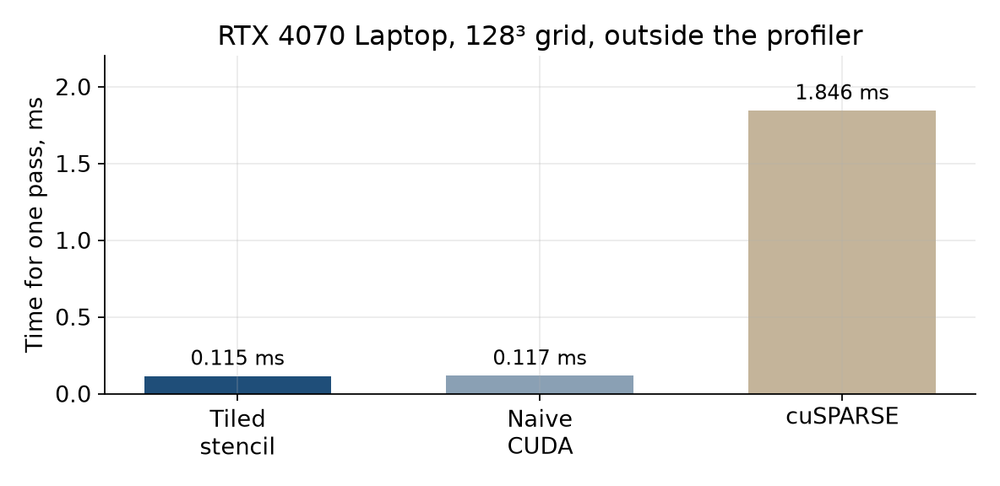

# The same neighbor calculation, packed two ways in GPU memory

A Laplacian on a cube looks at a cell and at every neighbor: 6 across the faces, 12 across the edges, and 8 at the corners. That is 27 numbers. The same pass shows up in pressure, heat, and any smooth correction of a field.

The tight part is not the arithmetic. The tight part is reading the numbers from memory in time. Two kernels compute the same formula. The naive one fetches neighbors from the card’s main memory on every cell. The other one stages a block of the field in the fast memory of the thread block, and passes neighbors along one axis from thread to thread through registers, with `__shfl_up_sync` and `__shfl_down_sync`.

Beside them, the same matrix is stored as a sparse table and multiplied by cuSPARSE. The table keeps 27 neighbor indices per cell. The stencil knows those indices from the shape of the grid, so it does not store them.

## Time on an RTX 4070 Laptop

Grid 128³. This run is outside the profiler.



The tiled stencil and the naive kernel take the same time, 0.115 ms and 0.117 ms. At this size the card’s shared cache already reuses neighbors, so the explicit packing does not shorten the run. Against the sparse table there is a gain: cuSPARSE takes 1.85 ms, and the stencil is 16× faster.

The difference from the same calculation on the CPU is 3.18×10⁻⁷. The limit was 10⁻⁶. It is met.

## What the profiler said

Nsight Compute looked at one `stencil_tiled` kernel.

| | |
| --- | --- |
| Duration | 143 microseconds |
| Fraction of peak DRAM | 22.9%, which is 58.6 GB/s out of 256 |
| L2 cache hit rate | 81.6% |
| L1 cache hit rate | 14.8% |
| Multiprocessor occupancy | 94.6% of 100% |
| Fraction of FP32 peak | 5% |

The requested limit was 80% of peak DRAM. It is missed. The program’s own console prints 146 GB/s and 57%, but that is the size of the input plus the output, divided by time. Less than that reaches the memory bus: the grid fits in L2, and after warmup the neighbors are read from there.

The card in the machine is an RTX 4070 Laptop, 36 multiprocessors. The binary was built for sm_89.

On an Apple M3, before any GPU was available, the same stencil in float matched double to 4.0×10⁻⁷. PyTorch was not run on this GPU.

## How to capture the Roofline screenshot

There is no Nsight image in the repository. The window opens only on the computer that has `runs\profile_report.ncu-rep`.

1. Open Nsight Compute. It is installed with the CUDA Toolkit. If the `ncu` command already runs, the app is installed too: in the Start menu it is called Nsight Compute.
2. File → Open File, and choose `C:\Users\lopat\random-projects\CUDA-Stencil-Poisson\runs\profile_report.ncu-rep`.
3. In the kernel list, select `stencil_tiled`. Pick one of the later launches, not the first. The first launches were warmup.
4. Open the Details page and find GPU Speed Of Light Roofline Chart.
5. Capture the window with Win+Shift+S and save it as `figures\roofline.png`.

That file is enough. Drop it next to the others and add one image line to this README.

## Run on Windows

You need the CUDA Toolkit and the Visual Studio C++ compiler, with the “Desktop development with C++” workload.

```bat
profile_4060.bat
```

The script finds `nvcc`, `cl.exe`, and `ncu`, builds the program, and runs it under Nsight. That pass takes several minutes. The profiler repeats every kernel dozens of times, and the milliseconds printed in that window are the time of those repeats. The stencil’s own speed is printed by running the built binary on its own:

```bat
runs\stencil_app.exe
```

The Roofline report is `runs\profile_report.ncu-rep`.
